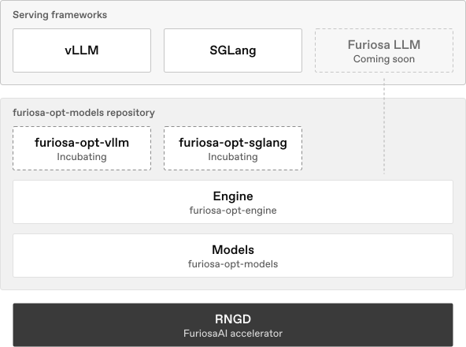

<p align="center">
  
</p>

<h1 align="center">furiosa-opt-models</h1>

<p align="center">
  <b>One model stack on FuriosaAI RNGD, for any serving framework.</b><br>
  vLLM and SGLang today, Furiosa LLM soon: each serves Hugging Face checkpoints through its own API, on the same model functions written in Rust.
</p>

<p align="center">
  <a href="https://github.com/furiosa-ai/furiosa-opt-models/actions/workflows/ci.yml"></a>
  <a href="https://developer.furiosa.ai/furiosa-opt-models/"></a>
  <a href="https://p.us3.datadoghq.com/sb/50b6828c-954c-11f0-ab6d-e612f3089d3f-50fb7cc2d833995137d3178e5aeb4c13"></a>
  <a href="LICENSE"></a>
</p>

<p align="center">
  <a href="https://developer.furiosa.ai/furiosa-opt-models/getting-started/installation/"><b>Installation</b></a> ·
  <a href="https://developer.furiosa.ai/furiosa-opt-models/getting-started/quickstart/"><b>Quickstart</b></a> ·
  <a href="https://developer.furiosa.ai/furiosa-opt-models/models/"><b>Models</b></a> ·
  <a href="https://developer.furiosa.ai/furiosa-opt-models/models/#how-availability-is-kept"><b>Performance</b></a> ·
  <a href="https://developer.furiosa.ai/furiosa-opt-models/design/architecture/"><b>Developer guide</b></a>
</p>

> [!WARNING]
> furiosa-opt-models is experimental. APIs, supported models and performance may change between versions without notice, and compatibility is not guaranteed until a stable release.

## Quickstart

With `cargo-furiosa-opt` installed ([Installation](https://developer.furiosa.ai/furiosa-opt-models/getting-started/installation/)), install the vLLM plugin from a clone of this repository and serve a checkpoint:

```bash
CARGO=cargo-furiosa-opt uv pip install --torch-backend cpu ./integrations/furiosa-opt-vllm
vllm serve Qwen/Qwen3-1.7B
```

The compiler comes from [furiosa-opt-preview](https://github.com/furiosa-ai/furiosa-opt-preview), where the next `cargo-furiosa-opt` release lands first: this repository uses compiler and `furiosa-opt-std` features that the latest release does not have yet.

The server speaks vLLM's OpenAI-compatible API; [Quickstart](https://developer.furiosa.ai/furiosa-opt-models/getting-started/quickstart/) shows SGLang and a first request.

## What you get

- **Framework agnostic.** The models and the engine know no serving framework; a thin plugin adapts each one, which keeps its own APIs, scheduling and sampling. vLLM and SGLang work today, and FuriosaAI's own engine, Furiosa LLM, is next.
- **Checkpoints, not conversions.** A Hugging Face checkpoint loads as it is when a compiled model fits its architecture; [Models](https://developer.furiosa.ai/furiosa-opt-models/models/) lists the ones that do.
- **One engine underneath.** The same compiled functions are callable from Python without a framework.
- **Measured continuously.** CI measures kernels, forward passes and serving on RNGD every night and on request for a pull request, and blocks regressions.

## How it fits together

<p align="center"><picture><source media="(prefers-color-scheme: dark)" srcset="docs/assets/stack-dark.svg"></picture></p>

The plugins incubate in this repository while the interface between frameworks and the engine is designed.
Once it settles, each moves to a dedicated repository, and this repository keeps the engine and the models.

- **Plugins.** [`furiosa-opt-vllm`](integrations/furiosa-opt-vllm/README.md) and [`furiosa-opt-sglang`](integrations/furiosa-opt-sglang/README.md) adapt each framework, incubating until they move to dedicated repositories.
- **Engine.** [`furiosa-opt-engine`](crates/furiosa-opt-engine/README.md) loads checkpoints, launches model functions and stores the KV cache, behind Python bindings.
- **Binding.** `furiosa-opt-python` is the engine's Python binding, the extension module the `furiosa_opt_engine` wheel installs.
- **Models.** [`furiosa-opt-models`](crates/furiosa-opt-models/README.md) holds the model functions, written in Rust.
- **Docs.** [`docs`](docs/index.md) is the source of the documentation site.

## License

Licensed under the [Apache License, Version 2.0](LICENSE).
